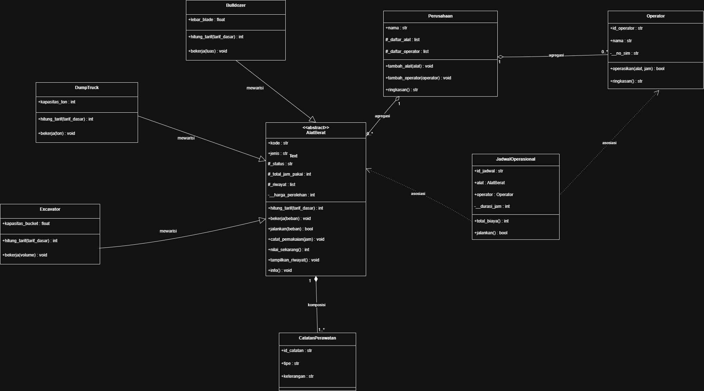
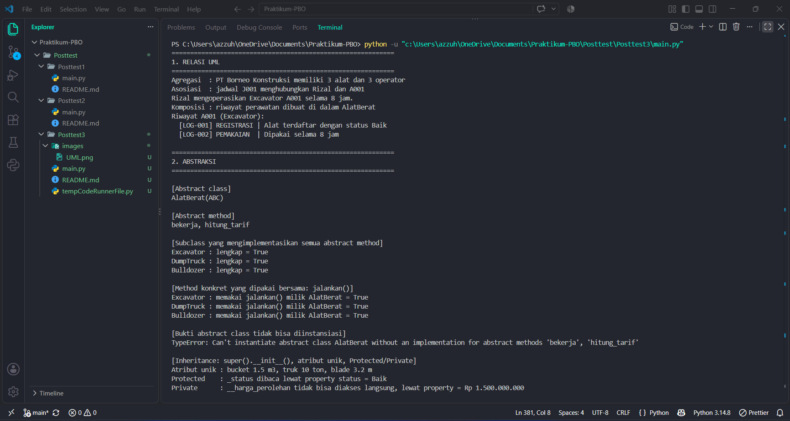
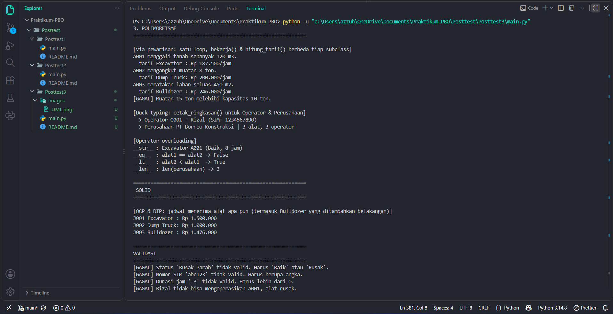

# Sistem Pendataan Jadwal Operasional Alat Berat pada Perusahaan Tambang

Program ini dibuat untuk tugas Pemrograman Berorientasi Objek (PBO), menerapkan konsep **Class & Object**, **Atribut & Method**, **Encapsulation**, **Relasi UML**, **Inheritance**, serta (posttest ini) **Abstraksi** dan **Polimorfisme**.

## Tentang Program

Program ini mencatat data **alat berat**, **operator**, dan **jadwal operasional** di sebuah perusahaan tambang. Setiap jadwal menghubungkan satu alat berat dengan satu operator, lalu menghitung total biaya sewanya. Tarif tiap alat berbeda sesuai jenisnya (Excavator, Dump Truck, atau Bulldozer).

## Struktur Class

Ada 8 class di dalam program ini:

### 1. `AlatBerat` (abstract class / superclass)
Menyimpan data umum semua alat berat. Class ini turunan `ABC` sehingga **tidak dapat diinstansiasi langsung**.
- `kode`, `jenis` → bisa diakses bebas (public)
- `_status` → data protected, bisa diubah lewat `status` (getter/setter). Nilai yang diterima hanya `"Baik"` atau `"Rusak"`.
- `__harga_perolehan` → data tersembunyi (private), hanya dipakai di dalam `AlatBerat` dan dibaca lewat property `harga_perolehan`.
- `total_alat` → menghitung jumlah alat yang sudah dibuat (atribut kelas).
- `hitung_tarif()` dan `bekerja()` → **abstract method**, wajib diimplementasikan subclass.
- `jalankan()` → method konkret yang dipakai bersama semua subclass.

### 2. `Excavator`, `DumpTruck`, dan `Bulldozer` (subclass dari `AlatBerat`)
- `Excavator` punya atribut unik `kapasitas_bucket`; `bekerja()` menggali tanah.
- `DumpTruck` punya atribut unik `kapasitas_ton`; `bekerja()` mengangkut muatan.
- `Bulldozer` punya atribut unik `lebar_blade`; `bekerja()` meratakan lahan.

### 3. `CatatanPerawatan`
Menyimpan satu baris riwayat alat (registrasi, pemakaian, perubahan status).

### 4. `Operator`
Menyimpan data operator.
- `id_operator`, `nama` → bisa diakses bebas (public)
- `__no_sim` → data tersembunyi (private), hanya bisa diubah lewat `no_sim` (getter/setter). Nilai yang diterima harus angka.
- `total_operator` → menghitung jumlah operator yang sudah dibuat (atribut kelas).
- `operasikan(alat, jam)` → operator menjalankan alat (ditolak jika alat rusak).

### 5. `Perusahaan`
Menampung daftar alat berat dan operator milik perusahaan.

### 6. `JadwalOperasional`
Menghubungkan `AlatBerat` dan `Operator` dalam satu jadwal kerja.
- `id_jadwal`, `alat`, `operator` → bisa diakses bebas (public)
- `__durasi_jam` → data tersembunyi (private), hanya bisa diubah lewat `durasi_jam` (getter/setter). Nilai harus lebih dari 0.
- `tarif_per_jam` → tarif dasar per jam, sama untuk semua jadwal (atribut kelas).
- `total_biaya()` → menghitung total biaya = durasi jam × tarif alat (hasil `hitung_tarif()` milik alat).
- `ubah_tarif()` → mengubah tarif dasar per jam untuk semua jadwal sekaligus.

## 1. Relasi UML

### Class Diagram



Keterangan simbol: `--|>` pewarisan, `*--` komposisi, `o--` agregasi, `-->` asosiasi, `..>` dependensi. Tanda `*` pada method menandakan abstract, `$` menandakan static/atribut kelas.

### Penjelasan Relasi

| Relasi | Kelas | Cara di kode | Alasan |
|---|---|---|---|
| Asosiasi | `JadwalOperasional` → `Operator` dan `AlatBerat` | `__init__` menyimpan `self.alat` dan `self.operator` yang diterima lewat parameter | Jadwal hanya menghubungkan satu alat dengan satu operator; ketiganya tetap objek yang berdiri sendiri dan tidak saling memiliki. |
| Agregasi | `Perusahaan` memiliki `AlatBerat` dan `Operator` | Objek dibuat di luar, lalu dimasukkan ke list lewat `tambah_alat()` dan `tambah_operator()` | Alat dan operator tetap ada walau perusahaan dihapus (bisa dipindah ke perusahaan lain), sehingga dipilih **agregasi**. |
| Komposisi | `AlatBerat` terdiri dari `CatatanPerawatan` | Catatan dibuat di dalam `AlatBerat` lewat `_buat_catatan()` dan disimpan di `_riwayat` | Riwayat tidak bermakna tanpa alatnya dan ikut hilang bersama alat, sehingga dipilih **komposisi**. |

Selain itu, `Operator` bergantung (dependensi) pada `AlatBerat` karena `operasikan(alat, jam)` hanya memakai alat sebagai parameter tanpa menyimpannya.

## 2. Inheritance

| Syarat | Penerapan |
|---|---|
| Superclass dan subclass | `AlatBerat` (superclass), `Excavator`, `DumpTruck`, dan `Bulldozer` (subclass) |
| `super().__init__(...)` | Dipanggil di konstruktor `Excavator`, `DumpTruck`, dan `Bulldozer` |
| Atribut unik | `Excavator.kapasitas_bucket`, `DumpTruck.kapasitas_ton`, `Bulldozer.lebar_blade` |
| Method overriding | `hitung_tarif()`, `bekerja()`, dan `info()` di-override di ketiga subclass |
| Protected (`_`) | `_status`, `_total_jam_pakai`, `_riwayat` di `AlatBerat`, dipakai di dalam `AlatBerat` dan diakses dari luar lewat property |
| Private (`__`) | `__harga_perolehan`, hanya dipakai di dalam `AlatBerat` |

### Contoh overriding

Tarif dasar Rp 150.000/jam, tiap subclass menghitung tarifnya sendiri:

| Alat | Rumus | Hasil |
|---|---|---|
| Excavator (bucket 1,5 m³) | tarif dasar + bucket x 25.000 | Rp 187.500/jam |
| Dump Truck (10 ton) | tarif dasar + ton x 5.000 | Rp 200.000/jam |
| Bulldozer (blade 3,2 m) | tarif dasar + blade x 30.000 | Rp 246.000/jam |

## 3. Abstraksi

| Syarat | Penerapan |
|---|---|
| Abstract class (ABC) | `AlatBerat(ABC)` |
| Minimal 2 `@abstractmethod` | `hitung_tarif(tarif_dasar)` dan `bekerja(beban)` |
| Minimal 2 subclass mengimplementasikan semua abstract method | `Excavator`, `DumpTruck`, dan `Bulldozer` mengimplementasikan keduanya |
| Method konkret yang dipakai bersama | `jalankan(beban)` di `AlatBerat`: mengecek status alat, lalu memanggil `bekerja()` milik subclass. Method konkret lain: `catat_pemakaian()`, `nilai_sekarang()`, `tampilkan_riwayat()`, `info()` |
| Bukti tidak bisa diinstansiasi | `AlatBerat(...)` dibungkus `try-except TypeError` (lihat output di bawah) |

Kode pembuktian di `main.py`:

```python
try:
    alat_abstrak = AlatBerat("X000", "Alat Abstrak", "Baik", 1000000)
except TypeError as e:
    print(f"TypeError: {e}")
```

Output:

```
TypeError: Can't instantiate abstract class AlatBerat without an implementation for abstract methods 'bekerja', 'hitung_tarif'
```

## 4. Polimorfisme

| Konsep | Penerapan |
|---|---|
| Polimorfisme via pewarisan | `bekerja()` dan `hitung_tarif()` di-override oleh `Excavator`, `DumpTruck`, `Bulldozer` dengan perilaku berbeda. Dipanggil dalam satu loop: `for alat, beban in zip(daftar_alat, (120, 8, 450)): alat.jalankan(beban)` |
| Duck typing | `Operator` dan `Perusahaan` tidak berhubungan lewat pewarisan, tetapi sama-sama punya `ringkasan()`. Keduanya dipanggil lewat satu fungsi, `cetak_ringkasan(sumber)` |
| Operator overloading | Di `AlatBerat`: `__str__` (teks alat), `__eq__` (sama jika `kode` sama, disertai `__hash__`), `__lt__` (dibandingkan jam pakai, dipakai `sorted()` di `Perusahaan.alat_terurut()`). Di `Perusahaan`: `__len__` (jumlah alat). Di `Operator`: `__str__` |
| Larangan anti-pattern | Tidak ada rantai `if/elif` yang mengecek `type()` atau string jenis alat. Satu-satunya `isinstance` ada di `AlatBerat.__eq__`, hanya untuk memastikan lawan bandingnya sesama `AlatBerat`, bukan untuk membedakan perilaku |

## SOLID

| Prinsip | Penerapan di kode |
|---|---|
| **OCP** (Open/Closed) | `Bulldozer` ditambahkan sebagai subclass baru tanpa mengubah `AlatBerat`, `Operator`, `JadwalOperasional`, maupun `Perusahaan`; semuanya langsung bekerja dengan alat baru tersebut. |
| **DIP** (Dependency Inversion) | `JadwalOperasional` dan `Operator.operasikan()` menerima objek alat dari luar (dependency injection) dan hanya memakai antarmuka `AlatBerat` (`hitung_tarif()`, `status`, `catat_pemakaian()`), bukan kelas konkret seperti `Excavator`. |

## Cara Menjalankan

```bash
python main.py
```

## Panduan Pengujian

Output program disusun mengikuti urutan bagian pada soal posttest:

1. **RELASI UML** — agregasi (`Perusahaan` memiliki alat dan operator), asosiasi (`JadwalOperasional` menghubungkan operator dan alat), dan komposisi (riwayat perawatan dibuat di dalam `AlatBerat`).
2. **ABSTRAKSI** — menampilkan abstract class `AlatBerat(ABC)`, daftar abstract method, status implementasi tiap subclass, bukti method konkret `jalankan()` dipakai bersama, **bukti `TypeError` saat abstract class diinstansiasi**, serta inheritance (atribut unik, Protected, Private).
3. **POLIMORFISME** — via pewarisan (satu loop memanggil `jalankan()` dan `hitung_tarif()`), duck typing (`cetak_ringkasan()`), dan operator overloading (`__str__`, `__eq__`, `__lt__`, `__len__`).
4. **NILAI PLUS: SOLID** — `JadwalOperasional` bekerja untuk Excavator, Dump Truck, dan Bulldozer tanpa perubahan kode (OCP & DIP).
5. **VALIDASI** — data tidak valid (status aneh, SIM huruf, durasi minus) ditolak, dan alat rusak tidak bisa dioperasikan.

## Output Program


